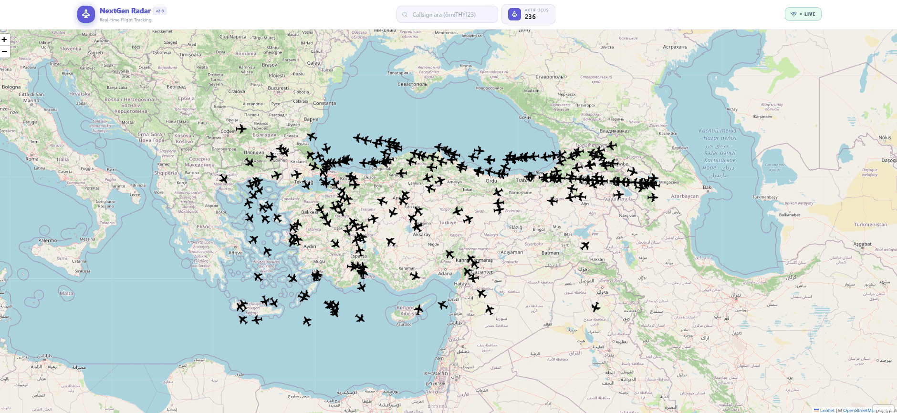

# ✈️ Flight Radar

**Flight Radar** is a modern and responsive flight tracking web application built with React 19 and Redux Toolkit. It allows users to monitor real-time flight data, explore aircraft locations on an interactive map, and access detailed flight information through a user-friendly interface.

---

## 📌 Project Overview

This project was developed to improve practical skills in React, API integration, interactive map visualization, and global state management. It focuses on creating a dynamic and responsive flight tracking experience using modern frontend technologies.

### ✨ Key Features

- ✈️ Real-time flight tracking and aircraft information
- 🗺️ Interactive map displaying aircraft locations
- 📋 Flight list view with detailed flight information
- 🔄 Dynamic flight data fetching through API integration
- 📱 Modern and responsive user interface
- ⚡ Efficient state management with Redux Toolkit
- 🔍 Interactive flight exploration

---

## 🛠️ Technologies Used

- **React 19** – Component-based UI development
- **Redux Toolkit & React Redux** – Global state management
- **JavaScript (ES6+)** – Application logic and functionality
- **Vite** – Fast development and optimized builds
- **Tailwind CSS 4.0** – Modern and responsive styling
- **Axios** – API integration and HTTP requests
- **Lucide React** – Modern UI icons

---

## 🎯 Project Purpose

The main goal of this project is to strengthen frontend development skills by integrating real-time flight data, asynchronous API operations, interactive map visualization, and Redux Toolkit state management into a modern React application.

---

## 🖥️ Project Preview

